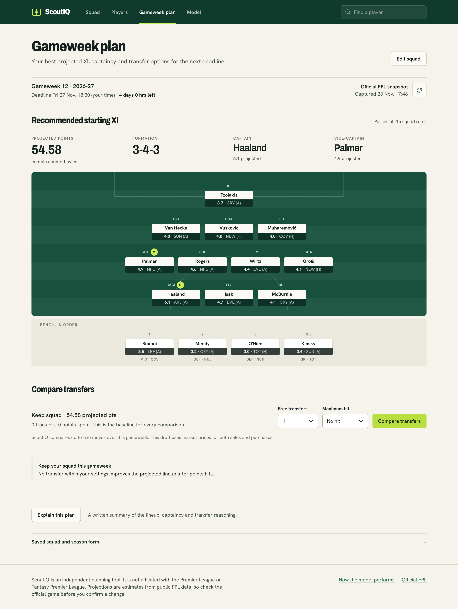
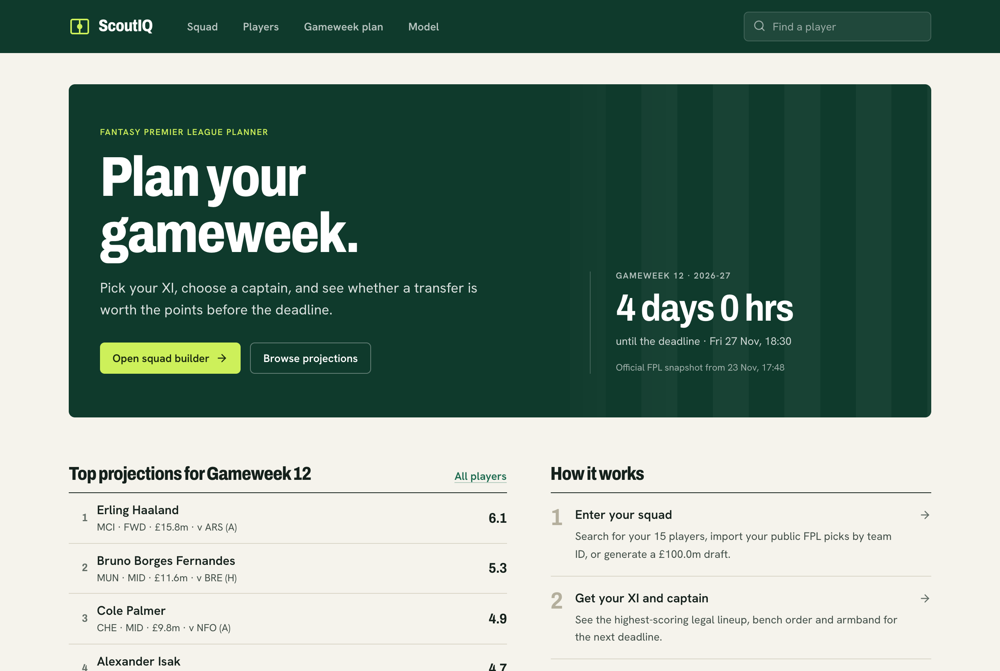
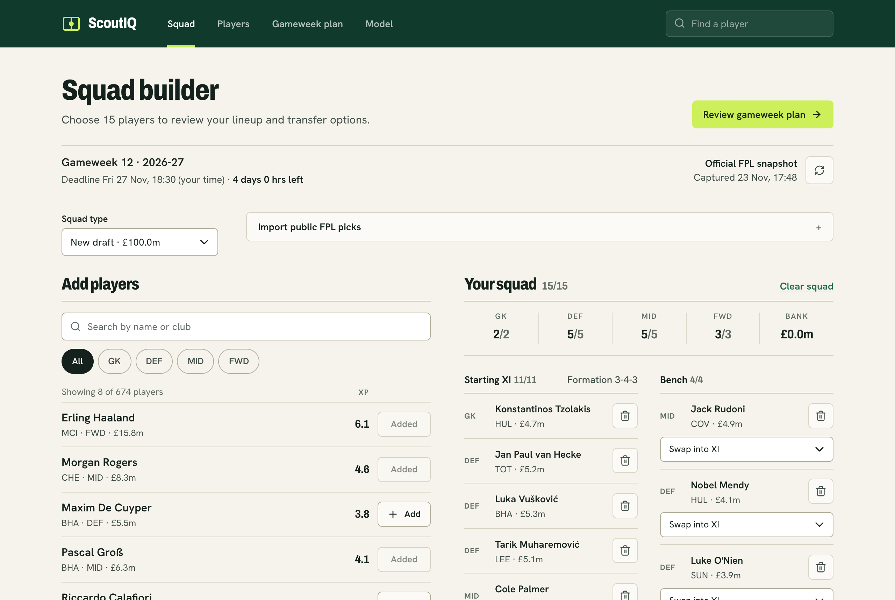
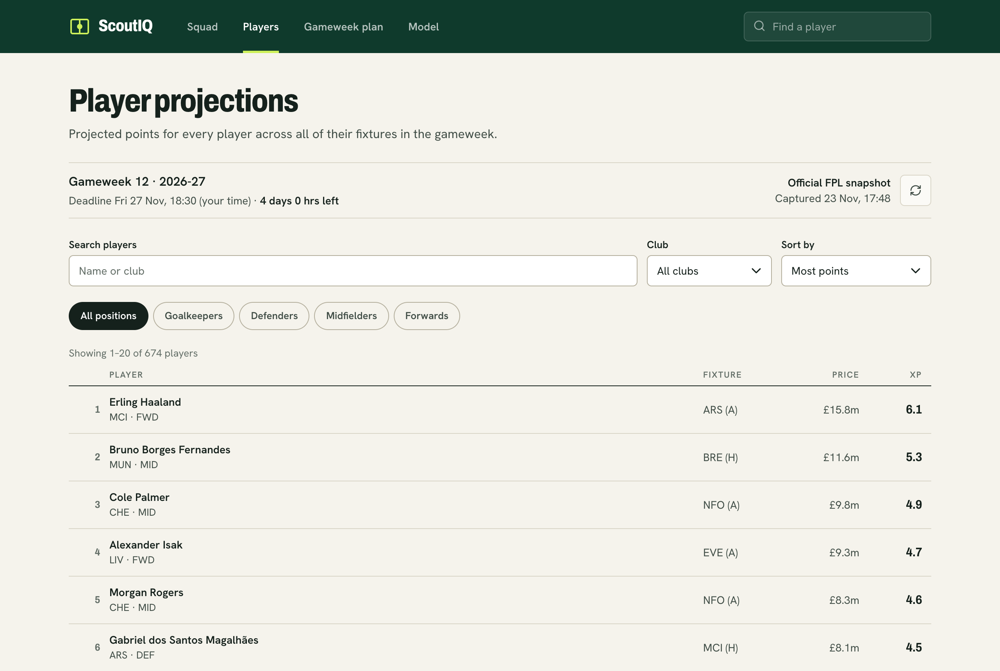
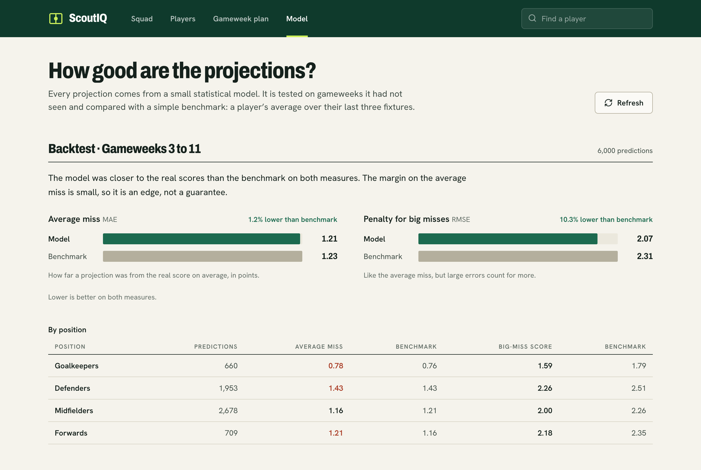

# ScoutIQ

[](https://github.com/Zepronex/ScoutIQ/actions/workflows/ci.yml)

ScoutIQ is a Fantasy Premier League gameweek planner. It projects points for every player, picks your best starting XI and captain, and tells you whether a transfer is worth the points before the deadline.



## What it does

- **Projections for every player.** A small statistical model estimates points for the next gameweek from form, minutes, price and fixture. It is tested each week against a simple benchmark and the results are shown in the app.
- **Your best XI and captain.** Enter your 15 players, import your public FPL picks by team ID, or generate a £100.0m draft. An optimizer picks the highest-scoring legal lineup and bench order.
- **Transfers judged on points.** Compare one or two moves against keeping your squad, using your real bank and selling prices and counting points hits.
- **A plain explanation.** Each plan can be summarised in text. The text is written by fixed rules by default, or by a language model if you configure one. Either way the optimizer has already made the decisions.

No account is needed. A saved squad stays in the visitor's browser.

| Home | Squad builder |
| --- | --- |
|  |  |

| Projections | Model results |
| --- | --- |
|  |  |

## How good are the projections?

The model is a ridge regression fitted to this season's results together with a stored summary of 2025-26. On the 23 November 2026 data (Gameweeks 3 to 11, 6,000 predictions tested walk-forward):

| | Model | Benchmark (last three fixtures) |
| --- | --- | --- |
| Average miss (MAE) | 1.21 | 1.23 |
| Penalty for big misses (RMSE) | 2.07 | 2.31 |

The model is ahead on both, by a small margin on the average miss. It uses only public FPL data, so it knows nothing about late team news, set-piece duty or rotation, and it looks one gameweek ahead. [Expected-points model](docs/EXPECTED_POINTS_BASELINE.md) has the detail.

## Run it locally

You need Node.js 22, pnpm 10, Python 3.12 or later, and Docker for PostgreSQL.

```sh
pnpm install
cp .env.example .env
docker compose up -d --wait postgres
pnpm run db:migrate
pnpm run refresh:fpl --fetch-history   # public FPL data, model, projections
pnpm run dev                           # web on :3000, API on :3001
```

Open <http://localhost:3000>. The refresh takes about a minute and can be repeated at any time.

If port 5432 is taken, set `POSTGRES_PORT` and the port in `DATABASE_URL` in `.env`.

## Tests

```sh
pnpm run build            # type-check and build API and web
pnpm run test:api         # API unit and integration tests
pnpm run model:test       # model tests
pnpm run pipeline:test    # pipeline tests
pnpm run test:browser     # Playwright journeys against a running app
```

The browser suite needs a running app and `pnpm exec playwright install chromium`. [Deploy ScoutIQ](docs/DEPLOYMENT.md#rehearse-locally-with-synthetic-data) shows how to run it against synthetic data, which is what CI does on every pull request.

## How it is built

```text
Public FPL API ─> ingestion (TypeScript) ─> features, model, backtest (Python)
                                                   │
                                                   ▼
Browser (React) <─ Express API: projections, optimizer, explanations <─ PostgreSQL
```

| Path | What lives there |
| --- | --- |
| `apps/web` | React and Vite web app |
| `apps/api` | Express API, ingestion, database loaders, lineup and transfer optimizer, explanation service |
| `pipelines/expected_points` | Feature building, the regression model, walk-forward backtest |
| `db/migrations` | PostgreSQL schema |
| `scripts` | Refresh, smoke check, browser tests, screenshot capture |
| `src/scoutiq_databricks`, `resources`, `databricks.yml` | A separate PySpark and Delta version of the pipeline for Databricks. The app does not depend on it. |

## Deploying

One container serves the web app and API, PostgreSQL holds the data, and a scheduled GitHub Actions workflow refreshes it four times a day. Expect about $6 to $9 a month on a host with a hard spending cap.

- [Deploy ScoutIQ](docs/DEPLOYMENT.md): setup, verification and rollback
- [Running costs and spending safeguards](docs/COSTS.md): price estimate and what stops a bot from running up the bill
- [Security](docs/SECURITY.md)
- [Environment reference](docs/ENVIRONMENT.md)

## More documentation

- [Architecture](docs/ARCHITECTURE.md)
- [Expected-points model](docs/EXPECTED_POINTS_BASELINE.md)
- [Prediction serving](docs/PREDICTION_SERVING.md)
- [Database](docs/DATABASE.md) and [ingestion](docs/INGESTION.md)
- [Command reference](docs/COMMAND_REFERENCE.md)
- [Databricks pipeline](docs/DATABRICKS.md)
- [Release readiness report](docs/PRODUCTION_READINESS.md)

## Limits

- Projections cover the next gameweek only. Chips, automatic substitutions and multi-week planning are out of scope.
- Imported picks are the last published deadline's squad. Bank and selling prices are entered by hand because FPL does not publish them.
- ScoutIQ is independent and is not affiliated with the Premier League or Fantasy Premier League.

## License

MIT. See [LICENSE](LICENSE).
